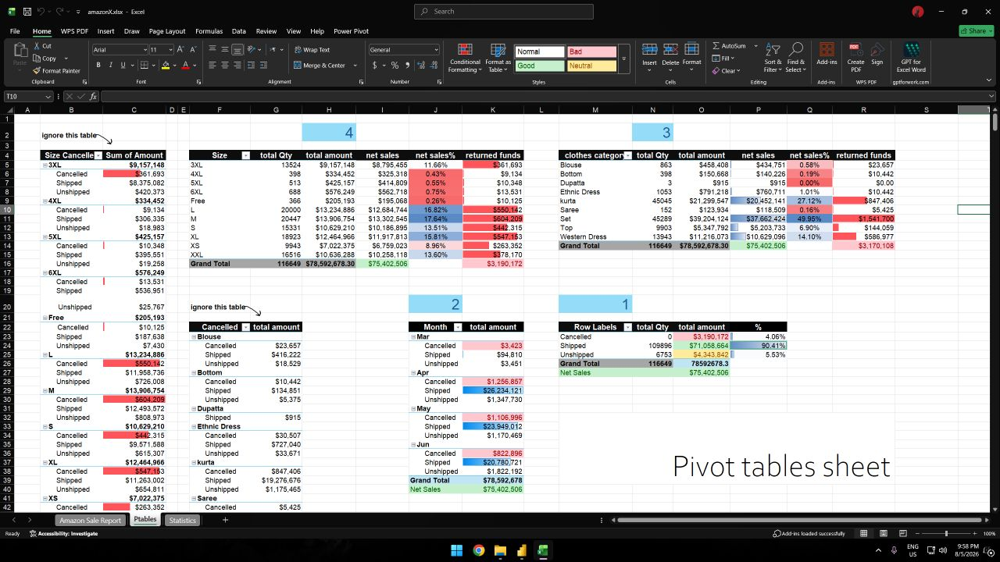
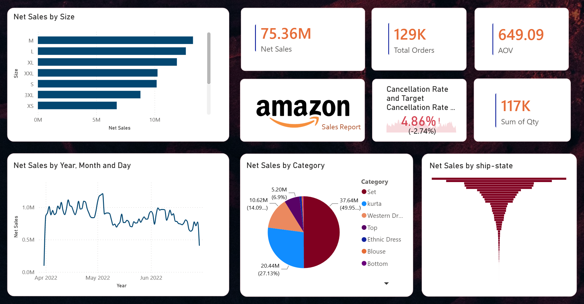

# Amazon Sales Analytics: Root Cause Analysis of Order Cancellations

---

## Overview

This is my first data analysis project, focusing on sales data from Amazon (India Region). 

The main goal of this analysis was to uncover the core reasons behind the unexpected spike in order cancellation rates during **April and May**, and to provide actionable recommendations to mitigate future revenue leakage.

---

## Methodology & Workflow

Data analytics heavily relies on data preparation—roughly 60% of the effort goes into cleaning and transforming data before diving into the exploratory analysis phase:

1. **Data Ingestion & Cleaning:** Extracted and cleaned the dataset using **Power Query**.
2. **Descriptive Statistics:** Verified data integrity using **Excel Analysis ToolPak**.
3. **Pivot Table Analysis:** Created multiple Pivot Tables to slice the data, identifying an overall baseline cancellation rate of **4.86%**.

---

## Key Diagnostic Findings

Through deep-dive data exploratory analysis, two primary root causes were identified:

* **Rising Temperatures (April & May):** Temperatures in India reach **35°C to 40°C** during these months as summer sets in. Consequently, buyers cancel previous orders placed for winter apparel.
* **Sizing Issues in Top Categories:** The highest cancellation volumes occurred in the **Set** and **Kurta** categories—despite being the top-selling product lines—due to sizing mismatch, specifically in **3XL, XL, and XS**.

---

## Recommendations & Actionable Solutions

| Area | Strategy |
| :--- | :--- |
| **Product & UX** | Add a thermal/fit guide on product pages (e.g., *"Relaxed fit designed for hot weather"*). |
| **Fulfillment Velocity** | Accelerate the initial packing phase (`processing in-pack`) within the first 2 hours of order placement. |
| **Retention Triggers** | Deploy an automated pop-up/message upon cancellation offering a **10% discount coupon** valid exclusively on summer wear. |
| **Dynamic Pricing** | Apply dynamic seasonal discounts to clear seasonal inventory faster. |

---

## Tools Used

* **Excel:** Pivot Tables & Analysis ToolPak
* **Power Query & Power Pivot**
* **Data Modeling & DAX**
* **Power BI**
